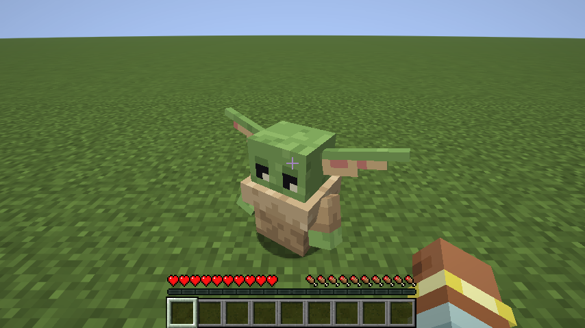
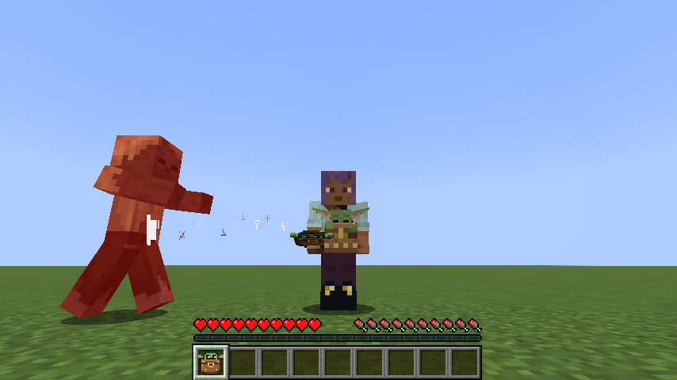
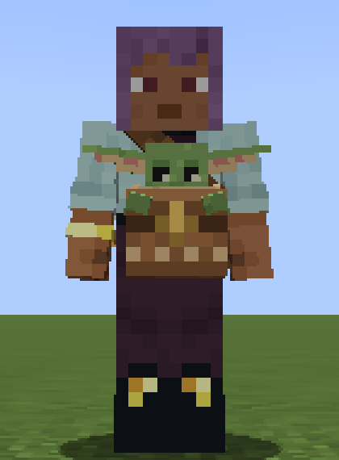
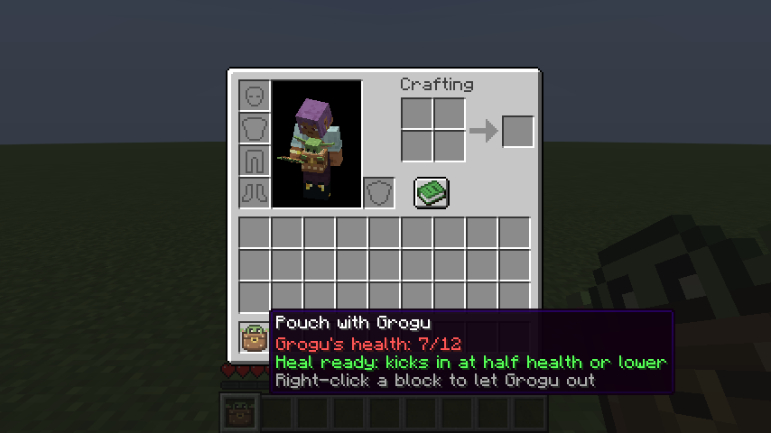

# Grogu Minecraft Mod (MKZV Craft)

[English](#english) · [Русский](#русский)



---

## English

A Fabric fan mod for Minecraft: a little Grogu you can tame and carry around in a pouch, who protects and heals you with the Force.

**Status: beta (0.1.0-beta).** Minecraft **26.3**, Fabric.

### Features

**Grogu** is a peaceful mob, a bit shorter than one block.
- Rarely found in swamps and mangrove swamps. There is also a spawn egg (Spawn Eggs tab).
- Tame him with **cookies** (1 in 3 chance). He eats cookies and fish.
- A tamed Grogu follows you; right-click makes him sit down or stand up.

**The Force**
- **Push:** when a monster gets close to Grogu or to you, he closes his eyes, stretches out his hand and throws it away.
- **Heal:** when you are at half health or lower, Grogu restores 4 hearts and gives you Regeneration. Once a minute.
- **Fatigue:** after a heal, or several pushes in a row, Grogu falls asleep for a while.



**Grogu's Pouch**
- Recipe: 2 string on top, 5 leather in a "U" shape.
- Right-click your Grogu with the pouch: he climbs in and the icon changes.
- While the pouch with Grogu is in your inventory, he rides on your belt (visible in third person, `F5`), protects and heals you. He slowly regains health in there.
- Right-click a block with the pouch to let him out. If you drop the pouch or die, he jumps out by himself.
- The pouch tooltip shows Grogu's health and whether his heal is ready.

<p>
  
  
</p>

### Installation

1. Minecraft **26.3** with [Fabric Loader](https://fabricmc.net/use/) 0.19.5 or newer.
2. Put into your `mods` folder:
   - [Fabric API](https://modrinth.com/mod/fabric-api) for 26.3;
   - `mkzvcraft-0.1.0-beta.jar` from the [Releases](../../releases) page.

### Building from source

Requires Java 25.

```bash
./gradlew build
```

The mod jar ends up in `build/libs/mkzvcraft-<version>.jar`.

- `./gradlew runClient` starts the game with the mod.
- `./gradlew runClientGameTest` runs in-game tests: it creates a world, checks the Force and the pouch, and saves screenshots to `build/run/clientGameTest/screenshots`.

### Disclaimer

This is an unofficial fan project. Grogu and Star Wars belong to Lucasfilm Ltd. and The Walt Disney Company. This project is not affiliated with them. All models and textures in the mod were made from scratch.

The mod's code is licensed under the terms in [LICENSE](LICENSE).

---

## Русский

Фанатский мод для Minecraft на Fabric: маленький Грогу, которого можно приручить и носить с собой в подсумке. Он защищает и лечит тебя с помощью Силы.

**Статус: beta (0.1.0-beta).** Minecraft **26.3**, Fabric.

### Что есть в моде

**Грогу** — мирный моб ростом чуть меньше блока.
- Редко встречается в болотах и мангровых болотах. Есть яйцо призыва (вкладка «Яйца призыва»).
- Приручается **печеньем** (шанс 1 к 3). Ест печенье и рыбу.
- Приручённый ходит за тобой, по ПКМ садится и встаёт.

**Сила**
- **Толчок:** если монстр подходит к Грогу или к тебе, Грогу закрывает глаза, тянет руку и отшвыривает его.
- **Лечение:** когда у тебя половина здоровья или меньше, Грогу восстанавливает 4 сердца и даёт регенерацию. Раз в минуту.
- **Усталость:** после лечения или нескольких толчков подряд Грогу засыпает.


**Подсумок для Грогу**
- Крафт: 2 нити сверху, 5 кожи (как буква «U»).
- ПКМ подсумком по своему Грогу — он залезает внутрь, иконка меняется.
- Пока подсумок с Грогу лежит в инвентаре, Грогу висит у тебя на поясе (видно в `F5`), защищает и лечит. В подсумке он потихоньку восстанавливает здоровье.
- ПКМ подсумком по блоку — Грогу вылезает. Если выбросить подсумок или умереть, он выпрыгнет сам.
- В подсказке к подсумку видно здоровье Грогу и готово ли лечение.

<p>
  
  
</p>

### Установка

1. Minecraft **26.3** с [Fabric Loader](https://fabricmc.net/use/) 0.19.5 или новее.
2. Положи в папку `mods`:
   - [Fabric API](https://modrinth.com/mod/fabric-api) для 26.3;
   - `mkzvcraft-0.1.0-beta.jar` со страницы [Releases](../../releases).

### Сборка из исходников

Нужна Java 25.

```bash
./gradlew build
```

Готовый мод: `build/libs/mkzvcraft-<версия>.jar`.

- `./gradlew runClient` — запустить игру с модом.
- `./gradlew runClientGameTest` — автотесты в игре: создают мир, проверяют Силу и подсумок и сохраняют скриншоты в `build/run/clientGameTest/screenshots`.

### Отказ от ответственности

Это неофициальный фанатский проект. Грогу и «Звёздные войны» принадлежат Lucasfilm Ltd. и The Walt Disney Company. Проект с ними не связан. Все модели и текстуры в моде сделаны с нуля.

Код мода распространяется по лицензии из файла [LICENSE](LICENSE).
