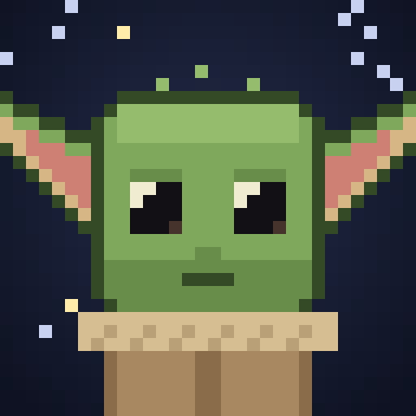
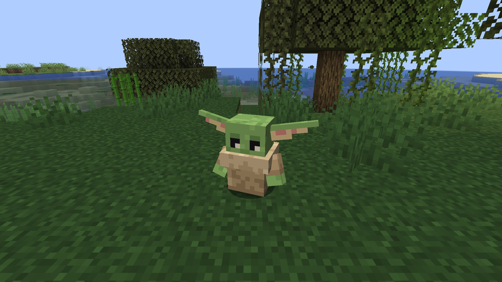
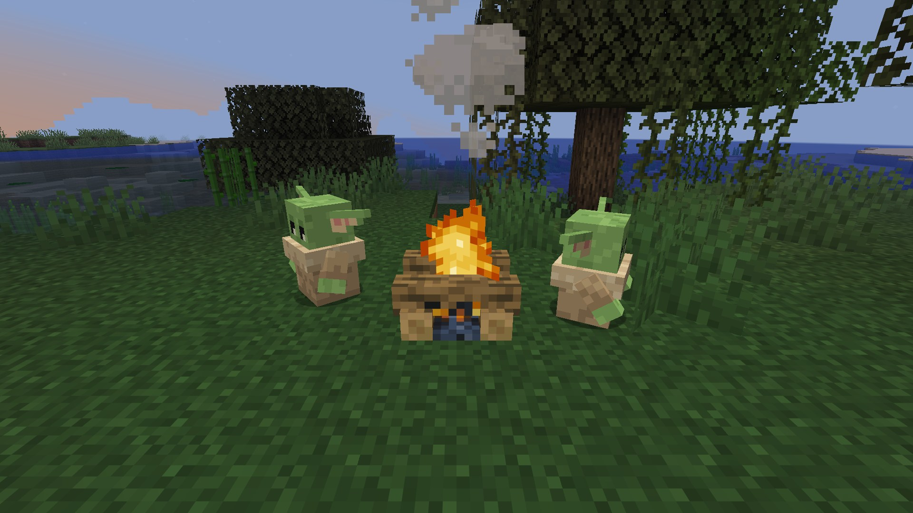
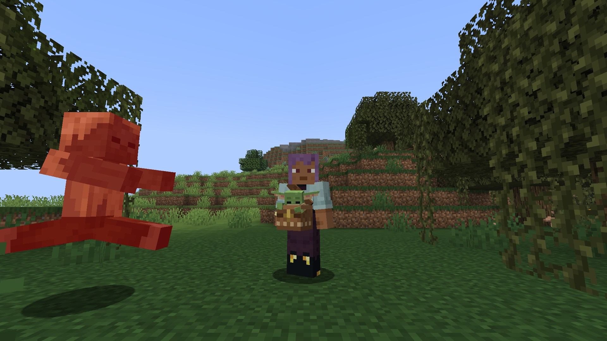
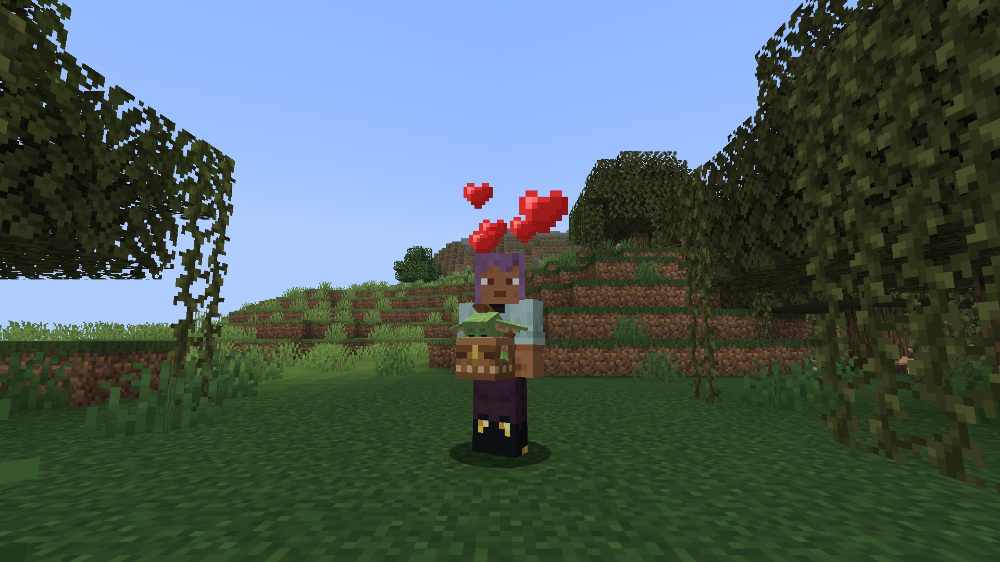
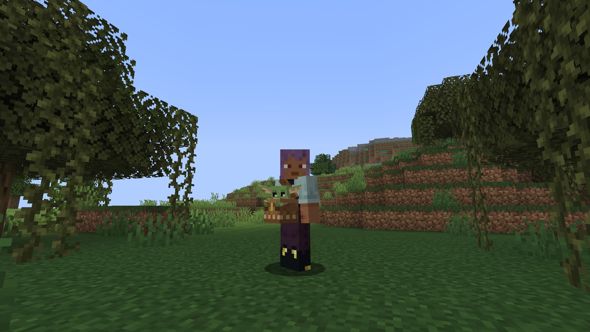

<p align="center">
  
</p>

<h1 align="center">Grogu</h1>

<p align="center">
  <b>A tiny Force user for Minecraft. Tame him, carry him in a pouch, and let him protect you.</b><br>
  <b>Маленький мастер Силы для Minecraft. Приручи его, носи в подсумке, и он будет тебя защищать.</b>
</p>

<p align="center">
  Minecraft 26.3 · Fabric · <a href="../../releases">Download / Скачать</a>
</p>

<p align="center">
  <a href="#english">English</a> · <a href="#русский">Русский</a>
</p>



---

## English

### ✨ Features

**🟢 Grogu.** A peaceful little mob, a bit shorter than a block. He lives in swamps and mangrove swamps (rarely!), and there is a spawn egg too.

**🍪 Taming.** Feed him **cookies** (1 in 3 chance). A tamed Grogu follows you everywhere, sits down on right-click and eats cookies and fish.



**💨 Force Push.** When a monster comes close to Grogu or to you, he closes his eyes, raises his hand and throws it away.



**💚 Force Heal.** When you drop to half health or lower, Grogu heals you for 4 hearts and gives you Regeneration. Once a minute.



**😴 Fatigue.** Big Force feats tire him out: after a heal, or several pushes in a row, he takes a nap.

**🎒 Grogu's Pouch.** Put Grogu in a pouch and he rides on your belt, still pushing monsters away and healing you.
- Right-click your Grogu with the pouch: he climbs in, and the icon shows him peeking out.
- The tooltip shows his health and when his heal is ready.
- Right-click a block to let him out. If you drop the pouch or die, he jumps out by himself.
- He slowly regains health while resting in the pouch.

<p>
  
  
</p>

**Pouch recipe:**
```
String   ·        String
Leather  ·        Leather
Leather  Leather  Leather
```

### 📦 Installation

1. Minecraft **26.3** with [Fabric Loader](https://fabricmc.net/use/) 0.19.5 or newer.
2. Put into your `mods` folder:
   - [Fabric API](https://modrinth.com/mod/fabric-api) for 26.3;
   - `grogu-0.1.0-beta+mc26.3.jar` from the [Releases](../../releases) page.
3. Needed on both the client and the server.

Commands for a quick try (cheats on):
```
/give @s grogu:grogu_spawn_egg
/give @s grogu:grogu_pouch
/give @s cookie 8
```

### 🛠 Building from source

Requires Java 25.

```bash
./gradlew build
```

The jar ends up in `build/libs/`. `./gradlew runClient` starts the game with the mod; `./gradlew runClientGameTest` runs in-game tests and saves screenshots to `build/run/clientGameTest/screenshots`.

### ⭐ Like it?

Star the repository and report bugs or ideas in [Issues](../../issues)!

---

## Русский

### ✨ Возможности

**🟢 Грогу.** Мирный маленький моб ростом чуть меньше блока. Живёт в болотах и мангровых болотах (редко!), есть и яйцо призыва.

**🍪 Приручение.** Корми его **печеньем** (шанс 1 к 3). Приручённый Грогу ходит за тобой повсюду, садится по ПКМ и ест печенье и рыбу.


**💨 Толчок Силой.** Если монстр подходит к Грогу или к тебе, Грогу закрывает глаза, поднимает руку и отшвыривает его.


**💚 Лечение Силой.** Когда у тебя половина здоровья или меньше, Грогу восстанавливает 4 сердца и даёт регенерацию. Раз в минуту.


**😴 Усталость.** Большие усилия его выматывают: после лечения или нескольких толчков подряд он засыпает.

**🎒 Подсумок для Грогу.** Посади Грогу в подсумок, и он поедет у тебя на поясе, продолжая отшвыривать монстров и лечить тебя.
- ПКМ подсумком по своему Грогу: он залезает внутрь, а на иконке видно, как он выглядывает.
- В подсказке видно его здоровье и когда будет готово лечение.
- ПКМ по блоку — выпустить. Если выбросить подсумок или умереть, Грогу выпрыгнет сам.
- В подсумке он потихоньку восстанавливает здоровье.

<p>
  
  
</p>

**Крафт подсумка:**
```
Нить   ·     Нить
Кожа   ·     Кожа
Кожа   Кожа  Кожа
```

### 📦 Установка

1. Minecraft **26.3** с [Fabric Loader](https://fabricmc.net/use/) 0.19.5 или новее.
2. Положи в папку `mods`:
   - [Fabric API](https://modrinth.com/mod/fabric-api) для 26.3;
   - `grogu-0.1.0-beta+mc26.3.jar` со страницы [Releases](../../releases).
3. Мод нужен и на клиенте, и на сервере.

Команды, чтобы быстро попробовать (с читами):
```
/give @s grogu:grogu_spawn_egg
/give @s grogu:grogu_pouch
/give @s cookie 8
```

### 🛠 Сборка из исходников

Нужна Java 25.

```bash
./gradlew build
```

Готовый файл появится в `build/libs/`. `./gradlew runClient` запускает игру с модом, `./gradlew runClientGameTest` гоняет автотесты в игре и сохраняет скриншоты в `build/run/clientGameTest/screenshots`.

### ⭐ Нравится?

Поставь звезду репозиторию и пиши о багах и идеях в [Issues](../../issues)!

---

<sub>Unofficial fan project. Grogu and Star Wars belong to Lucasfilm Ltd. and The Walt Disney Company; this project is not affiliated with them. All models and textures were made from scratch. Code license: see [LICENSE](LICENSE).</sub><br>
<sub>Неофициальный фанатский проект. Грогу и «Звёздные войны» принадлежат Lucasfilm Ltd. и The Walt Disney Company, проект с ними не связан. Все модели и текстуры сделаны с нуля. Лицензия кода — в файле [LICENSE](LICENSE).</sub>
